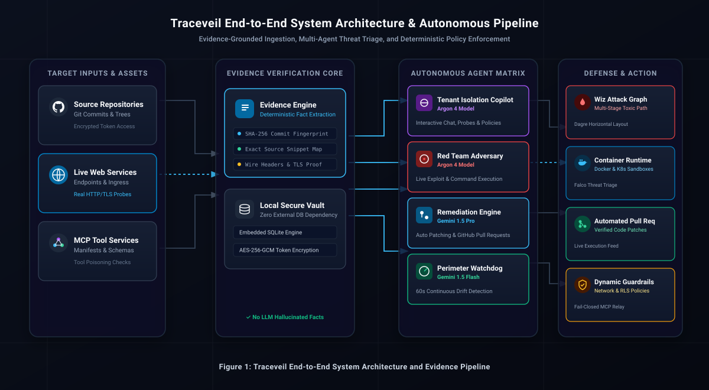

<div align="center">


# Traceveil

**Evidence-First Autonomous Security Graph, Agentic Defense, and Multi-Tenant Isolation Platform**

[](https://github.com/ritvikindupuri/Traceveil)
[](LICENSE)
[](https://react.dev/)
[](https://tanstack.com/start)
[](https://deepmind.google/technologies/gemini/)

</div>

---

## Overview

**Traceveil** is an enterprise-grade cloud-native security and agentic defense platform engineered to eliminate security hallucination. Traditional Cloud Security Posture Management (CSPM) tools and generic AI security copilots frequently report theoretical vulnerabilities disconnected from code reality. Traceveil enforces a strict **deterministic evidence baseline**: every entity, threat relationship, and remediation step is bound directly to verifiable Git commit SHAs, parsed container specifications, exact source code line numbers, or raw HTTP/TLS wire probes.

Traceveil bridges raw code repositories, live production web applications, containerized runtimes, and Model Context Protocol (MCP) tool pipelines into unified, multi-stage **Wiz-Style Toxic Attack Graphs**. Powered by a specialized multi-agent AI matrix running **Google Argon 4**, **Gemini 1.5 Pro**, and **Gemini 1.5 Flash**, Traceveil automates the entire security lifecycle—from adversarial red teaming and conversational multi-tenant isolation triage to one-click GitHub Pull Request generation and 60-second autonomous perimeter watchdog loops.

---

## Key Features

* **Deterministic Attack Graph Engine (Wiz-Style Visualizer)**: Synthesizes toxic risk combinations linking public ingress vectors, workload vulnerabilities, privilege escalations, and crown jewel datastores into an interactive Dagre horizontal topology powered by React Flow.
* **Conversational Tenant Isolation Copilot (Google Argon 4)**: An interactive security consultant equipped with prompt pills, live probe test widgets, and one-click policy generators synthesizing hardened PostgreSQL Row-Level Security (RLS) rules and Kubernetes zero-trust NetworkPolicies.
* **Autonomous Red Team Adversary (Google Argon 4)**: Executes real, unsimulated attack commands against target workloads to rigorously test privilege escalation boundaries, sensitive token leakage, and SSRF pivots with live stdout/stderr streams.
* **Automated Code Remediation & GitHub Pull Requests (Google Gemini 1.5 Pro)**: Automatically analyzes discovered toxic paths, drafts unified git diff patches, generates structured security advisories, and opens pull requests on GitHub with a real-time execution terminal feed.
* **Continuous 60-Second Perimeter Watchdog (Google Gemini 1.5 Flash)**: An autonomous background monitoring agent that scans target endpoints every minute, alerting security teams to perimeter drift such as missing Content Security Policies (CSP), HSTS downgrades, or accidental `.env` exposures.
* **Model Context Protocol (MCP) Guardrails Auditor**: Deeply inspects MCP tool manifests and execution transcripts to catch prompt injection, tool poisoning, schema tampering, and parameter escalation with fail-closed proxy relay protection.
* **Self-Contained Local Database & Cryptographic Vault**: Zero-cloud-dependency SQLite engine running in Write-Ahead Logging (WAL) mode with Drizzle ORM, Node `crypto.scrypt` password hashing, and AES-256-GCM authenticated encryption for private GitHub Personal Access Tokens (PATs).

---

## System Architecture

<p align="center">
  
</p>

<p align="center">
  <em>Figure 1: Traceveil End-to-End System Architecture and Evidence Pipeline</em>
</p>

### Step-by-Step Architecture Flow

1. **Target Ingestion & Ingress Preflight**: Users supply a GitHub repository URL, a live web endpoint domain, or an MCP server tool manifest. The ingestion layer initiates preflight checks, verifying network accessibility and decrypting user-stored GitHub PATs using server-side AES-256-GCM.
2. **Deterministic Evidence Extraction & Hash Binding**: 
   * For repositories: The engine traverses file trees, parses package lockfiles, evaluates Dockerfile/Kubernetes manifests, and pins every finding to immutable Git commit SHAs and source line intervals.
   * For live web applications: The engine executes direct HTTP/TLS network requests, inspecting server banners, transport ciphers, CSP directives, HSTS headers, and testing for exposed environment files.
3. **Toxic Combination & Graph Layout Synthesis**: The Graph Synthesizer processes validated evidence facts into a directed acyclic graph (DAG) modeled after the Wiz toxic combination formula (`Ingress` ➔ `Workload` ➔ `Vulnerability` ➔ `Privilege Escape` ➔ `Crown Jewel`). Dagre computes horizontal coordinates, and React Flow renders an interactive canvas with animated risk edges.
4. **Multi-Agent Intelligence Matrix**:
   * **Tenant Isolation Copilot** (*Argon 4*): Engages in structured conversational triage, evaluating cross-tenant boundary integrity and generating defensible boundary isolation policies.
   * **Red Team Adversary** (*Argon 4*): Formulates realistic adversary playbooks and executes command suites against workload boundaries with live terminal logging.
   * **Remediation Engine** (*Gemini 1.5 Pro*): Synthesizes precise code patches addressing root causes, creates GitHub pull request branches, and provides one-click merge automation.
   * **Perimeter Watchdog** (*Gemini 1.5 Flash*): Operates a continuous 60-second polling cycle against monitored targets to detect configuration drift and perimeter regressions.
5. **Autonomous Action & Zero-Trust Mitigation**: Operators review evidence in the sliding Evidence Drawer, approve automated GitHub PR submissions, copy generated RLS and NetworkPolicy rules, or export signed compliance audit artifacts.

---

## Tech Stack

### Frontend & Visualizer
* **Framework**: [TanStack Start](https://tanstack.com/start) with [React 19](https://react.dev/)
* **Styling & UI**: [Tailwind CSS v4](https://tailwindcss.com/), Radix UI Primitives, Lucide React Icons
* **Topology & Visualization**: `@xyflow/react` (React Flow), Dagre graph layout engine

### Artificial Intelligence & LLM Engine
* **SDK**: `@google/genai` (Google Gen AI SDK)
* **High-Complexity Reasoning & Red Teaming**: Google Argon 4
* **Precision Code Patching & PR Synthesis**: Google Gemini 1.5 Pro
* **High-Frequency Perimeter Monitoring**: Google Gemini 1.5 Flash
* **Deterministic Fallback Engine**: Local rule-based security reasoning engine

### Backend & Server Architecture
* **Server Framework**: TanStack Server Functions & Vite SSR
* **Runtime**: Node.js 20+ / Bun
* **Data Transport**: Server-Sent Events (SSE) streaming with NDJSON (Newline Delimited JSON)

### Storage & Security Vault
* **Database**: Embedded SQLite with WAL (Write-Ahead Logging) mode
* **ORM**: [Drizzle ORM](https://orm.drizzle.team/)
* **Cryptographic Vault**: AES-256-GCM symmetric encryption with HKDF key expansion
* **Authentication**: Node.js `crypto.scrypt` password hashing and secure HTTP session cookies

### Container Infrastructure & Sandboxes
* **Containerization**: Docker & Kubernetes (`kind` / local clusters)
* **Runtime Security Monitoring**: CNCF Falco & Falcosidekick

---

## Setup Instructions

### Prerequisites
* **Node.js**: `v20.0.0` or higher
* **Package Manager**: `npm` (v10+) or `bun`
* **Git**: `v2.40+`
* *(Optional)* **Gemini API Key**: Set `GEMINI_API_KEY` for live Google AI agent execution (Traceveil includes an integrated deterministic local security reasoning fallback if omitted).

### 1. Clone the Repository
```bash
git clone https://github.com/ritvikindupuri/Traceveil.git
cd Traceveil
```

### 2. Install Dependencies
```bash
npm install
```

### 3. Configure Environment Variables
Create a `.env` file in the project root:
```bash
cp .env.example .env
```

Configure the following variables in `.env`:
```env
# Google Gemini / Argon Model Access (Optional for cloud LLM execution)
GEMINI_API_KEY="your-gemini-api-key"

# Cryptographic Session & Vault Secret (Used for AES-256-GCM encryption)
SESSION_SECRET="generate-a-strong-32-byte-secret-key-here"

# Local Data Directory
DATA_DIR="./data"
```

### 4. Initialize Database
Initialize the embedded SQLite database schema:
```bash
npm run db:push
```

### 5. Start the Development Server
```bash
npm run dev
```
The application will start immediately at `http://localhost:3000`.

### 6. Build & Run for Production
```bash
# Build client and server bundles
npm run build

# Start production server
npm run start
```

### 7. Run Test Suite
Traceveil includes an extensive test suite verifying cryptographic hashing, graph synthesis, isolation policies, and routing:
```bash
npm test
```

---

## Usage Guide

### 1. Launching the Workspace Console
* Open your browser and navigate to `http://localhost:3000/console`.
* You will be greeted by the Traceveil investigation workspace with the sidebar tabs: **Attack Surface**, **Tenant Isolation**, **Findings**, **Security Agents**, **Remediation**, and **Autonomous Defense**.

### 2. Scanning a Target
Traceveil supports two distinct target modes via the mode switcher above the scan bar:

#### Mode A: GitHub Repository Scan
1. Click the **Repository** button.
2. Enter any public or private repository URL (e.g. `https://github.com/owner/repo`).
3. If scanning a private repository: Click **GitHub Credentials** in the top bar, enter your GitHub Personal Access Token (PAT), and click **Save Credential**. Your token is encrypted with AES-256-GCM and stored locally.
4. Check the box to authorize read-only analysis and click **Scan**.
5. Watch the real-time progress stream as the deterministic engine clones the commit tree, parses manifests, and synthesizes the topology.

#### Mode B: Live Web Application Scan
1. Click the **Live application** button.
2. Enter the target web domain or URL (e.g. `https://example.com` or `http://localhost:3000`).
3. Click **Scan**.
4. The scanner probes TLS parameters, HTTP response headers, CSP/HSTS configurations, and sensitive paths in real time.

### 3. Navigating Attack Surfaces & Wiz-Style Attack Paths
* **Topology Exploration**: Drag, pan, and zoom on the interactive React Flow canvas. Declared assets appear in neutral badges, while risky conditions are highlighted with warning indicators.
* **Isolating Toxic Attack Paths**:
  1. Click the **Attack paths** button in the header (marked with a flame icon).
  2. The canvas automatically filters out background nodes, isolating strictly the multi-stage toxic path from Public Ingress to the Crown Jewel database.
  3. Use the horizontal breadcrumb stepper at the top or click **Next Step** in the floating walkthrough card to step through each phase of the attack.
  4. Clicking any step auto-centers the canvas on the active node and opens the **Evidence Drawer** showing the exact HTTP headers, code lines, and remediation recommendations.

### 4. Collaborating with the Tenant Isolation Copilot (Argon 4)
1. Select the **Tenant isolation** tab from the left sidebar.
2. Review the prebuilt prompt pills at the top:
   * *"Test cross-tenant data leakage"*
   * *"Generate Row-Level Security policy"*
   * *"Analyze tenant isolation"*
   * *"Simulate noisy neighbor DOS"*
3. Click any pill or type a natural language prompt in the input bar.
4. The Argon 4 agent will respond with detailed analysis, generate executable probe verification widgets, and output copyable PostgreSQL RLS rules or Kubernetes zero-trust NetworkPolicy YAML manifests.

### 5. Running Red Team Simulations & Automated Remediation
1. Navigate to the **Security agents** tab to inspect the autonomous Red Team report. Review real executed exploit commands, observed process behaviors, and escape assessment verdicts.
2. Click the **Remediation** tab to inspect generated code patches.

#### How to Create Real Live PRs on Your Repository
1. In the top navigation bar of `http://localhost:3000/console`, click **GitHub Credentials**.
2. Paste a GitHub Personal Access Token (classic or fine-grained) with `repo` (content and pull request write) permissions and click **Save Credential**.
3. Go to the **Remediation** tab, enter your repository URL, and click **Agent Auto-Fix (PR & Merge)**.
4. The agent will push the real branch, open the real Pull Request on GitHub, and clicking **View on GitHub** will navigate directly to your live GitHub PR. (If no token is supplied, Traceveil seamlessly generates and downloads a cryptographically signed `.patch` bundle ready for manual `git apply`).


### 6. Continuous Perimeter Monitoring & MCP Tool Auditing
* **Autonomous Defense**: Click **Autonomous defense** to view the 60-second perimeter watchdog telemetry, historical drift alerts, and configured firewall rules.
* **MCP Tool Audits**: Click **MCP audits** in the bottom left sidebar to paste JSON/YAML Model Context Protocol manifests, evaluate prompt injection vectors, and set fail-closed destination rules.

---

## Technical Documentation Link

For an in-depth architectural breakdown, cryptographic proofs, data schemas, and API protocol specifications, please refer to the:

👉 **[Comprehensive Technical Documentation](TECHNICAL_DOCUMENTATION.md)**

---

## License

This project is licensed under the MIT License — see the [LICENSE](LICENSE) file for details.
