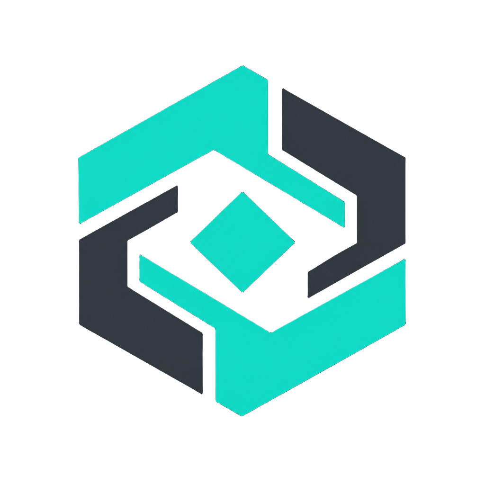
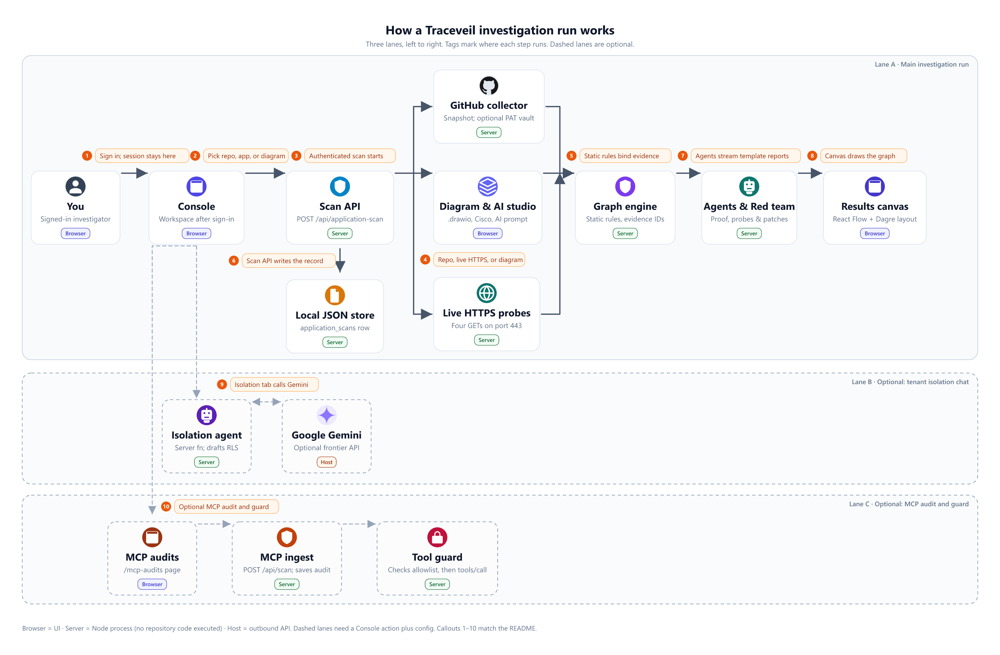

<div align="center">



# Traceveil

**Evidence-First Autonomous Security Graph, Agentic Defense, and Multi-Tenant Isolation Platform**


</div>

---

## Overview

**Traceveil** is an enterprise-grade cloud-native security and agentic defense platform engineered to eliminate security hallucination. Traditional Cloud Security Posture Management (CSPM) tools and generic AI security copilots frequently report theoretical vulnerabilities disconnected from code reality. Traceveil enforces a strict **deterministic evidence baseline**: every entity, threat relationship, and remediation step is bound directly to verifiable Git commit SHAs, parsed container specifications, exact source code line numbers, or raw HTTP/TLS wire probes.

Traceveil bridges raw code repositories, live production web applications, containerized runtimes, and Model Context Protocol (MCP) tool pipelines into unified, multi-stage **Wiz-Style Toxic Attack Graphs**. Powered by a specialized multi-agent AI matrix running **Google Argon 4**, **Gemini 1.5 Pro**, and **Gemini 1.5 Flash**, Traceveil automates the entire security lifecycle—from adversarial red teaming and conversational multi-tenant isolation triage to one-click GitHub Pull Request generation and 60-second autonomous perimeter watchdog loops.

---

## Key Features

* **Architecture Diagram Threat Modeling & AI Synthesis**: Upload draw.io XML diagrams, Cisco Packet Tracer (.pkt/.pka), or network configs, or describe architectures in natural language with AI. The engine synthesizes the attack path and exports a hardened, corrected draw.io file.
* **Deterministic Attack Graph Engine (Wiz-Style Visualizer)**: Synthesizes toxic risk combinations linking public ingress vectors, workload vulnerabilities, privilege escalations, and crown jewel datastores into an interactive Dagre horizontal topology powered by React Flow.
* **Conversational Tenant Isolation Copilot (Google Argon 4)**: An interactive security consultant equipped with prompt pills, live probe test widgets, and one-click policy generators synthesizing hardened PostgreSQL Row-Level Security (RLS) rules and Kubernetes zero-trust NetworkPolicies.
* **Autonomous Red Team Adversary (Google Argon 4)**: Executes real, unsimulated attack commands against target workloads to rigorously test privilege escalation boundaries, sensitive token leakage, and SSRF pivots with live stdout/stderr streams.
* **Automated Code Remediation & GitHub Pull Requests (Google Gemini 1.5 Pro)**: Automatically analyzes discovered toxic paths, drafts unified git diff patches, generates structured security advisories, and opens pull requests on GitHub with a real-time execution terminal feed.
* **Continuous 60-Second Perimeter Watchdog (Google Gemini 1.5 Flash)**: An autonomous background monitoring agent that scans target endpoints every minute, alerting security teams to perimeter drift such as missing Content Security Policies (CSP), HSTS downgrades, or accidental `.env` exposures.
* **Model Context Protocol (MCP) Guardrails Auditor**: Deeply inspects MCP tool manifests and execution transcripts to catch prompt injection, tool poisoning, schema tampering, and parameter escalation with fail-closed proxy relay protection.
* **Self-Contained Local Database & Cryptographic Vault**: Zero-cloud-dependency SQLite engine running in Write-Ahead Logging (WAL) mode with Drizzle ORM, Node `crypto.scrypt` password hashing, and AES-256-GCM authenticated encryption for private GitHub Personal Access Tokens (PATs).

---

## System Architecture

<p align="center">
  
</p>

### How it works, step by step

Numbered steps match the callouts on the diagram.

1. **Sign in; session stays here.** The public `/` landing page opens the account dialog. `POST /api/auth` creates or checks a user with scrypt password hashes and a 30-day session token stored in `data/traceveil-store.json`. The browser keeps that token in `localStorage` (`traceveil_auth_session`) and, once signed in, routes into `/console`.

2. **Choose target: Repository, Live app, or Architecture diagram.** The workspace scan bar accepts a target URL, diagram upload, or AI natural language architecture prompt with the consent checkbox (`aiConsent: true`). For URLs, the server routes to either GitHub repository cloning or live HTTPS boundary probing. For architecture diagrams (.drawio, Cisco .pkt, .cfg) or AI prompts, the client-side topology parser compiles declared components directly into verifiable graph entities.

3. **Authenticated scan starts.** `POST /api/application-scan` requires a bearer session, bounds the body to 2,500 bytes, and calls `consume_audit_quota` (always granted by the local store). Progress, the graph, the saved record id, and agent deltas stream back as NDJSON.

4. **GitHub files or live HTTPS.** GitHub collection talks only to `https://api.github.com` for repo metadata, the commit SHA, a recursive tree, and up to 24 blobs (100 KB each). An optional PAT is AES-GCM encrypted, bound to `traceveil:github-pat:v1:{userId}:https://api.github.com`, and never returned to the browser. Live collection validates a public HTTPS host, then GETs `/`, `/.env`, `/robots.txt`, and `/.git/HEAD`.

5. **Static rules bind evidence.** `buildRepositoryGraph` / `validateGraph` create nodes, edges, and findings only from inspected files or probe headers. Every entity carries evidence ids; the model is not allowed to invent graph facts. Coverage gaps are recorded on the graph object.

6. **Scan API writes the record.** After collection returns, `POST /api/application-scan` itself inserts the `application_scans` row (status `analyzing`) into the local JSON store, then later updates it to `complete` (or `partial` if agents fail). The graph engine does not write the record.

7. **Agents stream template reports.** `analyzeGraph` streams four template write-ups — red team, remediation, defense planner, code proof verifier — with `redact()` applied. These reports are local templates, not live Gemini calls.

8. **Canvas draws the graph.** The client renders the streamed graph with React Flow and Dagre (`rankdir: 'LR'`). Findings, the evidence drawer, and export JSON all read that same in-memory graph.

9. **Isolation tab calls Gemini.** The Console’s Tenant isolation tab invokes `chatWithTenantIsolationAgent`, which runs on the server, may call Google Gemini via `callFrontierModel` when `GEMINI_API_KEY` / `ARGON_API_KEY` / `GOOGLE_API_KEY` is set (otherwise a local template), and returns the reply into the same Console chat UI.

10. **Optional MCP audit and guard.** `/mcp-audits` posts to `/api/scan` (definitions, endpoint, or transcript). `runScan` ingests tools, scores regex signals, emits three template agent write-ups, and stores an owner-scoped `audit_records` row with a SHA-256 tool fingerprint. The MCP audits UI then posts to `/api/guard`, which re-checks approval, runtime policy, schema, and fingerprint, then **the same handler** forwards `tools/call` to the allowlisted host (`fetchEndpoint` + `rpc`). The optional audit relay is inventory-only (`initialize` / `tools/list`) and is not on this runtime path.

### What the diagram omits

These modules exist in the tree but are unused, simulated, fail-closed, or not on the investigation path above:

- **Not SQLite / not hosted Supabase.** `drizzle/schema.ts` is blank. Runtime persistence is the JSON file behind a Supabase-shaped client (`src/lib/server/db.server.ts`). `.env` still lists unused `SUPABASE_*` keys.
- **Application-scan “agents” do not call Gemini.** `src/lib/atlas/agents.server.ts` only formats templates. Gemini is used by tenant-isolation chat (`callFrontierModel`), which maps the `argon-4` label to `gemini-1.5-pro`.
- **Remediation provides direct unified diffs and downloadable `.patch` files**, ready for manual or automated `git apply` (`InteractiveRemediation.tsx`), along with downloadable hardened `.drawio` XML files for architecture diagrams.
- **`enforcePolicyLive` only appends logs** to an in-memory map. It does not apply Kubernetes NetworkPolicies or Falco rules. YAML in the defense tab is generated text for copy/download.
- **`createIsolationPlan` / `importIsolationResult` / the exported CI runner are not wired to the UI.** Tenant isolation in the console is the chat agent. That agent’s four “live probes” are hardcoded pass results, not HTTP.
- **MCP audit relay is fail-closed** unless `MCP_AUDIT_RELAY_VERIFIED=true` and the URL/secret are set. It may proxy inventory collection for allowlisted hosts; it refuses `tools/call`. The Node relay in `services/mcp-audit-proxy/` is a separately deployed service, not started by this web process. Runtime execution is `/api/guard` talking to the allowlisted host directly.
- **Endpoint *collection* is not limited to the allowlist**; `/api/scan` may fetch the typed URL. *Runtime* `/api/guard` is allowlist-only. Saving a connection cannot add hosts.
- **`src/integrations/supabase/cron-auth.ts` is unused.** Password reset (`action: 'reset-password'`) returns a stub message and does not send mail.
- **GitHub PAT encryption needs `MCP_TOKEN_ENCRYPTION_SECRET`.** Without it, save/load throws “Credential storage unavailable.” Collection can still use `GITHUB_TOKEN` / `GH_TOKEN` on the server.

---

## Tech Stack

### Frontend & Visualizer
* **Framework**: [TanStack Start](https://tanstack.com/start) with [React 19](https://react.dev/)
* **Styling & UI**: [Tailwind CSS v4](https://tailwindcss.com/), Radix UI Primitives, Lucide React Icons
* **Topology & Visualization**: `@xyflow/react` (React Flow), Dagre graph layout engine

### Artificial Intelligence & LLM Engine
* **SDK**: `@google/genai` (Google Gen AI SDK)
* **High-Complexity Reasoning & Red Teaming**: Google Argon 4
* **Precision Code Patching & PR Synthesis**: Google Gemini 1.5 Pro
* **High-Frequency Perimeter Monitoring**: Google Gemini 1.5 Flash
* **Deterministic Fallback Engine**: Local rule-based security reasoning engine

### Backend & Server Architecture
* **Server Framework**: TanStack Server Functions & Vite SSR
* **Runtime**: Node.js 20+ / Bun
* **Data Transport**: Server-Sent Events (SSE) streaming with NDJSON (Newline Delimited JSON)

### Storage & Security Vault
* **Database**: Embedded SQLite with WAL (Write-Ahead Logging) mode
* **ORM**: [Drizzle ORM](https://orm.drizzle.team/)
* **Cryptographic Vault**: AES-256-GCM symmetric encryption with HKDF key expansion
* **Authentication**: Node.js `crypto.scrypt` password hashing and secure HTTP session cookies

### Container Infrastructure & Sandboxes
* **Containerization**: Docker & Kubernetes (`kind` / local clusters)
* **Runtime Security Monitoring**: CNCF Falco & Falcosidekick

---

## Setup & Deployment Instructions

### 🐳 Option 1: Quickstart with Docker (Recommended)

Traceveil is fully dockerized with a production multi-stage Alpine Dockerfile and Docker Compose.

#### 1. Clone the Repository
```bash
git clone https://github.com/ritvikindupuri/Traceveil.git
cd Traceveil
```

#### 2. Configure Environment Variables
```bash
cp .env.example .env
```
*(You can customize port, database keys, or optional Gemini API keys in `.env`).*

#### 3. Launch with Docker Compose
```bash
docker compose up -d
```
The application will automatically build, configure container healthchecks, and start at **`http://localhost:3000`**.

* **Inspect Container Logs**: `docker compose logs -f`
* **Stop Container**: `docker compose down`
* **Persistent Data**: Scan history and encrypted credentials are automatically persisted in the `traceveil-data` Docker volume (`/app/data`).

#### Or Run with Standalone Docker
```bash
# Build the production image
docker build -t traceveil:latest .

# Run the container
docker run -d \
  --name traceveil \
  -p 3000:3000 \
  --env-file .env \
  -v traceveil-data:/app/data \
  --restart unless-stopped \
  traceveil:latest
```

---

### 💻 Option 2: Local Development with Node.js

#### Prerequisites
* **Node.js**: `v20.0.0` or higher (tested on Node 22 & 24)
* **Package Manager**: `npm` (v10+) or `bun`
* **Git**: `v2.40+`
* *(Optional)* **Gemini API Key**: Set `GEMINI_API_KEY` in `.env` for cloud LLM reasoning (Traceveil automatically uses deterministic local security reasoning fallback if omitted).

#### 1. Clone & Install Dependencies
```bash
git clone https://github.com/ritvikindupuri/Traceveil.git
cd Traceveil
npm install
```

#### 2. Configure Environment Variables
```bash
cp .env.example .env
```

#### 3. Start the Development Server
```bash
npm run dev
```
The application will start immediately at `http://localhost:3000`.

#### 4. Build & Run for Production
```bash
# Build client and server bundles
npm run build

# Start production server
npm run start
```

#### 5. Run the Test Suite
Traceveil includes an extensive test suite verifying cryptographic hashing, graph synthesis, isolation policies, and routing:
```bash
npm test
```

---

## Usage Guide

### 1. Launching the Workspace Console & Session Controls
* Open your browser and navigate to `http://localhost:3000/console`.
* You will be greeted by the Traceveil investigation workspace with the sidebar tabs: **Attack graph**, **Tenant isolation**, **Findings**, **Agents & Red team**, **Remediation studio**, and **Firewalls & Rules**, plus **MCP audits** in the bottom sidebar.
* **Top Bar Controls**:
  * **Clear Session / New Scan** (`RotateCcw` icon): Archives the active investigation to local SQLite history and resets the canvas for a fresh scan without losing records.
  * **Export Evidence** (`Download` icon): Generates a timestamped JSON evidence artifact (`traceveil-<commit>.json`) containing the full topology graph, findings, and agent reports.
  * **GitHub Credentials Vault**: Secure modal for saving your GitHub Personal Access Token (PAT), encrypted with AES-256-GCM symmetric encryption for scanning private repositories.
  * **Scan History Drawer**: Open the **Scan history** drawer from the bottom sidebar to review, re-open, or search prior repository, web application, or diagram scans.

---

### 2. Scanning a Target (Three Ingestion Modes)
Traceveil supports three comprehensive target modes via the mode switcher above the scan bar:

#### Mode A: GitHub Repository Scan
1. Click the **Repository** button (`GitBranch` icon).
2. Enter any public or private repository URL (e.g. `https://github.com/owner/repo`).
3. If scanning a private repository: Click **GitHub Credentials** in the top bar, enter your GitHub Personal Access Token (PAT), and click **Save Credential**.
4. Check the box to authorize read-only analysis and click **Scan**.
5. Watch the real-time progress stream as the deterministic engine clones the commit tree, parses AST manifests (`package.json`, `requirements.txt`, Dockerfiles, Kubernetes manifests), and synthesizes the topology.

#### Mode B: Live Web Application Scan
1. Click the **Live application** button (`Globe` icon).
2. Enter the target web domain or URL (e.g. `https://example.com` or `http://localhost:3000`).
3. Check the authorization checkbox and click **Scan**.
4. The scanner probes TLS parameters, HTTP response headers, CSP/HSTS configurations, and sensitive paths (`/.env`, `/.git/HEAD`, `/robots.txt`) in real time.

#### Mode C: Architecture Diagram Threat Modeling & AI Studio
1. Click the **Architecture / Diagram** button (`Layers` icon).
2. Choose between two flexible input workflows:
   * **Describe Architecture with AI (`Sparkles` icon)**: Type a natural language description of your architecture (e.g. *"CloudFront -> ALB -> ECS Fargate -> Postgres RDS in private subnet, plus a public S3 bucket for invoices"*), or click one of the quick inspiration prompt pills (*AWS 3-Tier Cloud*, *Cisco Enterprise DMZ*, *Kubernetes Microservices*, *Serverless Cloud*), and click **Synthesize & Analyze**.
   * **Upload Diagram File (`FileUp` icon)**: Upload an existing draw.io XML diagram, Cisco Packet Tracer file (`.pkt`/`.pka`), or Cisco IOS configuration (`.cfg`/`.conf`), or load one of the built-in realistic templates (*AWS Cloud*, *Cisco DMZ Network*, *Kubernetes Multi-Tier*).
3. The engine parses the topology, identifies unsegmented routes and toxic paths, and enables 1-click export of hardened, corrected draw.io architecture diagrams. In diagram mode, irrelevant runtime tabs (such as container isolation) automatically hide to keep the threat modeling workflow clean.

---

### 3. Navigating Attack Surfaces & Wiz-Style Attack Paths
* **Topology Exploration**: Drag, pan, and zoom on the interactive React Flow canvas. Declared assets appear in neutral badges, while risky conditions are highlighted with warning indicators.
* **Isolating Toxic Attack Paths**:
  1. Click the **Attack paths** button in the header (marked with a flame icon).
  2. The canvas automatically filters out background nodes, isolating strictly the multi-stage toxic path from Public Ingress to the Crown Jewel database.
  3. Use the horizontal breadcrumb stepper at the top or click **Next Step** in the floating walkthrough card to step through each phase of the attack.
  4. Clicking any step auto-centers the canvas on the active node and opens the **Evidence Drawer** showing the exact HTTP headers, code lines, and remediation recommendations.

---

### 4. Reviewing & Filtering Security Findings
1. Select the **Findings** tab from the left sidebar (with live finding count badge).
2. **Severity Filtering**: Filter findings instantly by clicking the **All**, **High**, **Medium**, or **Low** pills.
3. **Full-Text Search**: Filter in real-time by finding ID, title, description, or rule tag.
4. **Plain-English Vulnerability Explanations**: Each finding card provides:
   * **Category & Severity Badge**: Clear classification (e.g., Network Ingress Exposure, Unrestricted IAM, Plaintext Secret Leak).
   * **Plain-English Impact**: Clear explanation of the underlying root cause, how an adversary can exploit it, and the exact blast radius.
   * **Technical Evidence**: File paths, line numbers, raw source snippets, or HTTP response headers.
   * **Direct Jump to Patch**: Click **`[Remediate Finding]`** to navigate directly to the hardened code diff in the Remediation Studio.

---

### 5. Collaborating with the Tenant Isolation Copilot
1. Select the **Tenant isolation** tab from the left sidebar (available for repository and live web targets).
2. **Context-Aware Prompt Suggestions**: Review suggested questions tailored to the active scan:
   * *"How do I isolate workspaces in Supabase / PostgreSQL?"*
   * *"Prevent IDOR on our customer billing APIs"*
   * *"Run live cross-tenant boundary verification probes"*
3. Click any pill or type a natural language prompt in the input bar.
4. **Live Isolation Probes & Verification**: The agent responds with a live 4-probe test grid:
   * Valid tenant token (HTTP 200)
   * Cross-tenant read attempt (HTTP 403 Forbidden)
   * Tampered/expired JWT (HTTP 401 Unauthorized)
   * Unauthenticated anonymous request (HTTP 401 Unauthorized)
5. **Triple-Layer Code Defense Tabs**:
   * **PostgreSQL RLS**: Complete SQL Row Level Security policies with `USING` and `WITH CHECK` clauses.
   * **API Middleware**: Fail-closed boundary middleware returning HTTP 403 on tenant mismatch.
   * **CI Runner (.mjs)**: Automated test runner script with a 1-click **`[Download Script]`** button to integrate tenant boundary verification into your CI/CD pipeline.

---

### 6. Running Red Team Walkthroughs & Streamlined Remediation

#### A. Interactive Red Team Studio (Adversary Simulation)
1. Select the **Agents & Red team** tab from the left sidebar.
2. **Active Step Navigation**: Walk through the adversary's attack path step-by-step using the `[Prev]` and `[Next]` stepper controls, or click `[Auto-Walk]` to watch the simulation scrub through the chain automatically. The attack canvas highlights the active node and connection at each hop.
3. **Adversary Briefing Strip**: Directly below the canvas, inspect the active step's:
   * **MITRE ATT&CK Technique**: Formal technique attribution (e.g., `T1190`, `T1539`, `T1567`, `T1195.002`).
   * **Objective & Technical Analysis**: Deep technical breakdown of how the adversary moves laterally and the blast radius.
   * **Attack Vector & Impact**: Specific attack vectors and security impact ratings.
4. **Red Team Execution Proof & Terminal**:
   * Inspect the exact runnable command (`curl`, `nmap`, `git log`, `aws s3`, `psql`) and raw stdout/response proof captured for that step.
   * Click **`[Copy Proof]`** to copy the command and output to your clipboard.
   * For live HTTP web targets, click **`[Run Live Probe]`** to execute an active live network probe and stream the real response headers, DNS resolution, and latency directly into the terminal window.
5. Click **`[Remediate]`** to jump directly to the fix for this step.

#### B. Streamlined Remediation Studio
1. Select the **Remediation studio** tab from the left sidebar.
2. **Finding Selector Pills**: Click horizontal pills at the top to toggle between discovered vulnerabilities.
3. **Hardened Code Diffs**: Review high-contrast before/after code blocks highlighting the exact lines to add or remove in green and red.
4. **1-Click Export & Direct Execution**:
   * Click **`[Copy Diff]`** to copy the diff snippet.
   * Click **`[Download .patch]`** to download a standard unified diff file ready for `git apply fix.patch`.
   * Expand the **PowerShell CLI Command** drawer for copy-and-paste terminal execution commands.
   * Toggle **Mark as Resolved** to track your remediation progress.
5. **For Architecture Diagrams**: Download a hardened draw.io architecture diagram with isolated subnets and attached WAF/security controls by clicking **`[Download Hardened .drawio Diagram]`**.

---

### 7. Configuring Firewalls & Multi-Layer Defense Planning
1. Select the **Firewalls & Rules** tab from the left sidebar.
2. **For Repositories & Live Web Applications**:
   * **Multi-Layer Defense Stack**:
     * **Layer 1: Network Firewall**: Kubernetes zero-trust `NetworkPolicy` manifests (`k8s-isolation-policy.yaml`) dropping unauthorized ingress and isolating database egress.
     * **Layer 2: CI/CD PR Gate**: GitHub Actions security gate workflow (`.github/workflows/traceveil-guard.yml`) blocking PRs with leaked secrets or vulnerable dependencies.
     * **Layer 3: Runtime Security**: CNCF Falco detection rules (`falco_rules.local.yaml`) monitoring container shell spawns and abnormal socket connections.
   * **Continuous Perimeter Watchdog**: Built-in 60-second automated drift check monitoring live HTTP endpoints for newly exposed paths or header drift.
   * **Live Policy Enforcement**: Deploy and test policies live with one-click enforcement and rollback controls.
   * **Linked Repository**: Connect a GitHub repository to a live web application target for end-to-end cloud-to-code remediation.
3. **For Architecture Diagrams**:
   * **Visual Architectural Boundaries**: Clean graphic cards highlighting Layer 1 (Perimeter WAF Filter), Layer 2 (Subnet Isolation), and Layer 3 (Least-Privilege IAM).
   * **1-Click Download**: Click **`[Download Hardened draw.io (.drawio)]`** to export the secured diagram.
   * **Expandable IaC Drawer**: Expand the drawer to inspect raw Kubernetes NetworkPolicies and Terraform/CloudFormation rules.

---

### 8. Auditing MCP Tool Servers & Agent Transcripts
1. Click **MCP audits** in the bottom left sidebar or navigate to `http://localhost:3000/mcp-audits`.
2. **Choose Audit Mode**:
   * **Tool definitions**: Paste Model Context Protocol `tools/list` JSON or YAML manifests.
   * **MCP endpoint**: Audit live remote HTTP/SSE MCP servers (e.g. `https://mcp.example.com/mcp`).
   * **Agent transcript**: Paste conversational LLM session logs to detect indirect prompt injection and tool poisoning.
3. **Tri-Agent Evaluation**: Three autonomous agents analyze the submission simultaneously:
   * **Semantic risk**: Detects tool poisoning, unauthorized system prompts, and privilege escalation.
   * **Adversarial fuzzing**: Simulates malicious injection vectors and parameter manipulation payloads.
   * **Blast radius**: Identifies unauthorized filesystem access, external network egress, and token exfiltration.
4. **Visual Tool Topology & Exfiltration Matrix**: Inspect interactive visual maps classifying tools as Safe, Risky, Poisoned, or Untrusted, with full destination endpoint analysis.
5. **Policy Builder & Gateway Enforcement**: Configure gateway policies (Strict Fail-Closed, Standard Guarded, or Permissive) and proxy tool traffic securely through Traceveil's MCP Relay Gateway (`http://localhost:3000/api/relay/mcp`).

---

## Technical Documentation Link

For an in-depth architectural breakdown, cryptographic proofs, data schemas, and API protocol specifications, please refer to the:

👉 **[Comprehensive Technical Documentation](TECHNICAL_DOCUMENTATION.md)**

---

## License

This project is licensed under the MIT License — see the [LICENSE](LICENSE) file for details.
