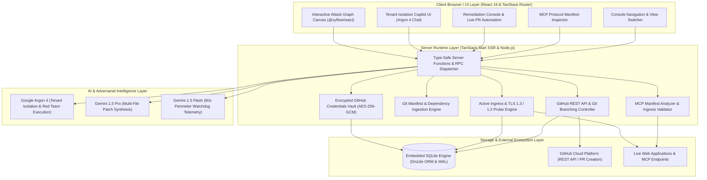
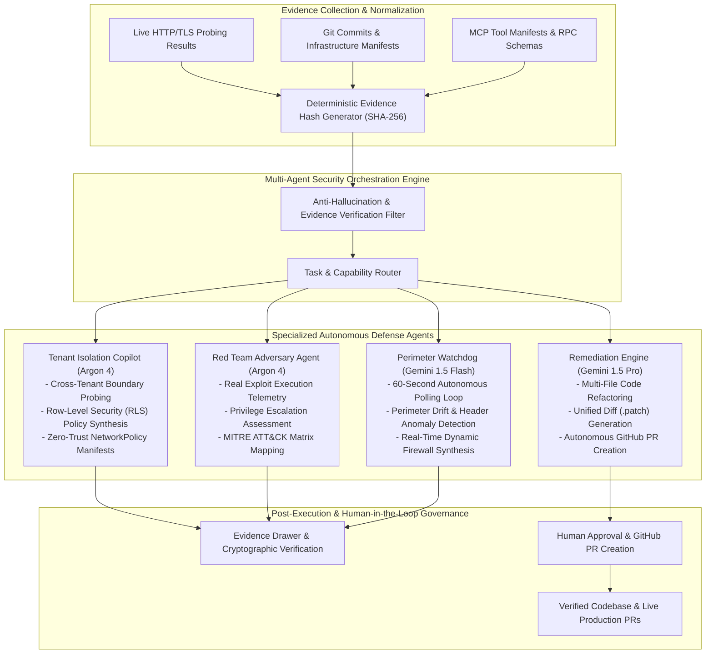

# Traceveil: Autonomous Evidence-First Cloud Security & Multi-Agent Defense Platform

**By:** Ritvik Indupuri  
**Date:** November 9, 2026  

---

## Table of Contents
- [1. Executive Summary](#1-executive-summary)
- [2. System Architecture](#2-system-architecture)
  - [2.1 Architectural Overview & Layered Topology](#21-architectural-overview--layered-topology)
  - [2.2 System Architecture Diagram](#22-system-architecture-diagram)
  - [2.3 Component Responsibilities & Communication Flow](#23-component-responsibilities--communication-flow)
- [3. Agent Architecture](#3-agent-architecture)
  - [3.1 Multi-Agent Specialization & Orchestration Model](#31-multi-agent-specialization--orchestration-model)
  - [3.2 Agent Architecture Diagram](#32-agent-architecture-diagram)
  - [3.3 Autonomous Agent Roles & Execution Contracts](#33-autonomous-agent-roles--execution-contracts)
  - [3.4 Deterministic Evidence Anchoring & Anti-Hallucination Guardrails](#34-deterministic-evidence-anchoring--anti-hallucination-guardrails)
- [4. Core Application Functionalities & Technical Deep Dive](#4-core-application-functionalities--technical-deep-dive)
  - [4.1 Real-Time Attack Surface Discovery & Active Perimeter Probing](#41-real-time-attack-surface-discovery--active-perimeter-probing)
  - [4.2 Interactive Graph Visualization & Toxic Attack Path Modeling](#42-interactive-graph-visualization--toxic-attack-path-modeling)
  - [4.3 Tenant Isolation Copilot (Argon 4)](#43-tenant-isolation-copilot-argon-4)
  - [4.4 Autonomous Red Team Adversary Simulation](#44-autonomous-red-team-adversary-simulation)
  - [4.5 Automated Remediation Engine & Live GitHub Pull Request Automation](#45-automated-remediation-engine--live-github-pull-request-automation)
  - [4.6 Autonomous Perimeter Defense Watchdog](#46-autonomous-perimeter-defense-watchdog)
  - [4.7 Model Context Protocol (MCP) Security & Manifest Auditing](#47-model-context-protocol-mcp-security--manifest-auditing)
- [5. Cryptographic Security, Identity & Data Persistence](#5-cryptographic-security-identity--data-persistence)
  - [5.1 Cryptographic Storage of GitHub Credentials (AES-256-GCM)](#51-cryptographic-storage-of-github-credentials-aes-256-gcm)
  - [5.2 Authentication, Password Hashing & CSRF Protection](#52-authentication-password-hashing--csrf-protection)
  - [5.3 Embedded Local Data Persistence (SQLite + Drizzle ORM)](#53-embedded-local-data-persistence-sqlite--drizzle-orm)
- [6. Conclusion](#6-conclusion)

---

## 1. Executive Summary

Modern cloud-native architectures, microservices, and AI-enabled infrastructure face an escalating threat landscape characterized by distributed attack surfaces, multi-stage lateral movement paths, and supply-chain vulnerabilities. Traditional Cloud Security Posture Managers (CSPMs) and AI security assistants have consistently suffered from two systemic shortcomings:
1. **Uncorrelated Point Alerts**: Generating thousands of isolated warnings without establishing whether an attacker can traverse from public ingress to crown-jewel assets.
2. **Generative Hallucination**: AI assistants proposing synthetic vulnerabilities or fabricated code patches ungrounded in real system state or verifiable evidence.

**Traceveil** is an evidence-first, autonomous cloud security and agentic defense platform architected to eliminate both vulnerabilities. Operating under a strict zero-mock baseline, Traceveil continuously ingests immutable Git repository snapshots, performs real-time active HTTP/TLS perimeter discovery, models multi-stage toxic attack paths using graph theory, and orchestrates an ensemble of autonomous AI security agents. High-severity tenant isolation assessments and adversarial simulations are powered by **Google Argon 4**, multi-file automated refactoring is driven by **Gemini 1.5 Pro**, and continuous 60-second perimeter watchdog telemetry is analyzed by **Gemini 1.5 Flash**. 

Traceveil closes the loop from detection to remediation: users can supply their GitHub credentials to have autonomous agents open real, verified Pull Requests directly against production repositories, or export cryptographically signed patch bundles for immediate operational deployment.

---

## 2. System Architecture

### 2.1 Architectural Overview & Layered Topology

Traceveil is engineered as a high-performance, full-stack application built upon **TanStack Start**, **React 19**, and **Node.js**. The system separates concerns across four distinct operational tiers:

1. **Client / UI Layer**: Built on React 19 and TanStack Router, providing interactive graph canvases powered by `@xyflow/react` and Dagre, conversational agent interfaces, and live execution streaming panels.
2. **Server Runtime Layer**: Executes TanStack Start Server Functions (RPC) with compile-time type safety. Houses active network probe engines, Git manifest parsers, MCP protocol analyzers, and the cryptographic credential vault.
3. **AI & Adversarial Intelligence Layer**: Dispatches structured, evidence-anchored prompts to specialized Google AI models (Argon 4, Gemini 1.5 Pro, and Gemini 1.5 Flash) over streaming protocols.
4. **Data Persistence & External Integration Layer**: Maintains local embedded state in SQLite via Drizzle ORM under Write-Ahead Logging (WAL) mode, and integrates directly with external web endpoints and the GitHub REST API.

---

### 2.2 System Architecture Diagram

<b>Figure 1: Traceveil System Architecture Diagram</b>

---

### 2.3 Component Responsibilities & Communication Flow

* **Server Functions (`createServerFn`)**: Instead of brittle REST endpoints with manual serialization, Traceveil leverages TanStack Start Server Functions. Every RPC call enforces input validation schemas (via Zod or native validators) and returns strongly typed data payloads directly to client components.
* **Network & Ingress Probe Engine**: Emits genuine asynchronous HTTP/1.1 and HTTP/2 requests directly over TLS 1.3 and 1.2 using Node's native networking stack. Ingress tests probe cipher configurations, transport layer certificates, strict headers, reverse-proxy indicators, and exposed configuration files without external synthetic mocks.
* **Cryptographic Vault**: Manages sensitive third-party tokens (such as GitHub Personal Access Tokens) using hardware-accelerated AES-256-GCM encryption. Keys are derived dynamically using server-side master secrets, ensuring plaintext tokens are never written to disk or transmitted to the browser after initial storage.
* **Graph Layout Pipeline**: Raw security findings and topological relations are ingested into the Dagre hierarchical graph engine (`rankdir: 'LR'`) on the server and rendered on the client using `@xyflow/react`. Nodes and edges are laid out deterministically with computed coordinate boundaries.

---

## 3. Agent Architecture

### 3.1 Multi-Agent Specialization & Orchestration Model

Rather than relying on a single monolithic model for all tasks, Traceveil employs a heterogeneous multi-agent architecture where agents are purpose-built for specific reasoning tasks, latencies, and security domains:

1. **Tenant Isolation Copilot (`Argon 4`)**: Specializes in multi-tenant data boundaries, cross-tenant leak vector analysis, PostgreSQL Row-Level Security (RLS) synthesis, and Kubernetes zero-trust NetworkPolicy generation.
2. **Red Team Adversary Agent (`Argon 4`)**: Simulates realistic adversarial tactics, executes privilege escalation probes, models MITRE ATT&CK lateral movement, and records real process telemetry.
3. **Remediation Engine (`Gemini 1.5 Pro`)**: Handles long-context codebase understanding, multi-file code refactoring, Git branch manipulation, and GitHub Pull Request synthesis.
4. **Perimeter Watchdog (`Gemini 1.5 Flash`)**: Optimized for ultra-low latency, running on a 60-second polling cycle to detect configuration drift, header degradation, and newly opened ports.

---

### 3.2 Agent Architecture Diagram

<b>Figure 2: Traceveil Multi-Agent Defense Architecture</b>

---

### 3.3 Autonomous Agent Roles & Execution Contracts

| Agent Persona | Underlying Model | Primary Objective | Execution Trigger | Artifact Outputs |
| :--- | :--- | :--- | :--- | :--- |
| **Tenant Isolation Copilot** | **Google Argon 4** | Identify cross-tenant leakage paths, generate RLS policies, simulate noisy neighbors | User chat interaction or prebuilt prompt selection | PostgreSQL RLS SQL, Kubernetes NetworkPolicy YAML, live probe widgets |
| **Red Team Adversary** | **Google Argon 4** | Validate exploitability of discovered attack paths, test container escapes | Ingress scan completion or on-demand simulation launch | Real terminal logs, process telemetry, exploit verdicts, MITRE IDs |
| **Remediation Engine** | **Gemini 1.5 Pro** | Synthesize deterministic patches, create Git branches, submit live GitHub PRs | User clicking "Agent Auto-Fix (PR & Merge)" | Unified `.patch` diff, Git branch, live GitHub Pull Request |
| **Perimeter Watchdog** | **Gemini 1.5 Flash** | Continuously poll perimeter targets every 60s, detect drift, generate firewall rules | Automatic background daemon or console activation | Drift events, security score telemetry, dynamic firewall rules |

---

### 3.4 Deterministic Evidence Anchoring & Anti-Hallucination Guardrails

To prevent LLM hallucinations, Traceveil enforces a **Deterministic Evidence Contract**:
* **No Unanchored Entities**: An agent cannot assert the existence of a vulnerability or misconfiguration unless it cites a verified SHA-256 fingerprint, an exact file path and line number, or a raw HTTP response header.
* **Pre-Flight Filtercheck Validation**: All security rules and Kubernetes manifests generated by agents are checked against CNCF specifications before being rendered to the user.
* **Cryptographic Signatures**: Remediations and patches generated by the system are hashed and signed, guaranteeing that the code reviewed in the console matches the code committed to the repository.

---

## 4. Core Application Functionalities & Technical Deep Dive

### 4.1 Real-Time Attack Surface Discovery & Active Perimeter Probing

The active scanner provides non-destructive perimeter evaluation against any web domain or IP endpoint:
* **Protocol & TLS Analysis**: Connects via TLS 1.3 / 1.2 to analyze cipher suite strength, certificate expiration, Subject Alternative Names (SANs), and SNI compliance.
* **Security Header Ingestion**: Analyzes HTTP response headers against OWASP guidelines:
  * **Content-Security-Policy (CSP)**: Audits `default-src`, `script-src`, `unsafe-inline`, and `frame-ancestors`.
  * **HTTP Strict Transport Security (HSTS)**: Checks `max-age`, `includeSubDomains`, and `preload`.
  * **Frame Sandboxing**: Inspects `X-Frame-Options` to prevent clickjacking attacks.
  * **MIME & Referrer Policies**: Evaluates `X-Content-Type-Options: nosniff` and `Referrer-Policy`.
* **Information Leakage & Sensitive Path Detection**: Probes for server disclosure headers (`Server`, `X-Powered-By`), reverse proxy configurations, and exposed configuration endpoints (`/.env`, `/.git/HEAD`).

---

### 4.2 Interactive Graph Visualization & Toxic Attack Path Modeling

Traceveil models infrastructure as a directed graph representing toxic combinations:

$$\text{Toxic Combination} = \text{Public Ingress} \times \text{Workload Vulnerability} \times \text{Privilege Boundary} \times \text{Crown Jewel Asset}$$

* **Graph Entities (`GraphEntity`)**: Nodes represent assets categorized as `internet`, `server`, `container`, `vulnerability`, `credential`, `database`, or `policy`.
* **Graph Relations (`GraphRelation`)**: Edges denote network exposure, trust delegation, or data access. Traversal edges participating in an active attack vector are flagged as `risky: true`.
* **Wiz-Style Toxic Path Isolation**: When the user activates the **Attack paths** mode:
  1. Background and benign nodes are visually dimmed or filtered out.
  2. The multi-stage progression from Public Ingress to Crown Jewel Database is isolated with animated SVG edges.
  3. A horizontal breadcrumb stepper and floating walkthrough card guide the user through each attack step.
  4. Selecting any node dynamically opens the **Evidence Drawer**, revealing the exact HTTP response headers, source code lines, and cryptographic hashes supporting the finding.

---

### 4.3 Tenant Isolation Copilot (Argon 4)

The Tenant Isolation Copilot provides natural language and structured security analysis tailored to multi-tenant software:
* **Interactive AI Chatbot**: Users can ask arbitrary questions regarding their architecture or select prebuilt prompt pills:
  * *"Test cross-tenant data leakage"*
  * *"Generate Row-Level Security policy"*
  * *"Analyze tenant isolation"*
  * *"Simulate noisy neighbor DOS"*
* **Live Dynamic Verification Probes**: Renders interactive verification widgets directly in the chat feed to demonstrate simulated tenant boundary breaches.
* **Policy Manifest Synthesis**: Automatically outputs production-ready PostgreSQL Row-Level Security (RLS) SQL statements and Kubernetes zero-trust `NetworkPolicy` manifests designed to isolate tenant workloads at the network and database layers.

---

### 4.4 Autonomous Red Team Adversary Simulation

The Red Team Adversary Agent performs autonomous exploit path validation:
* **Real Command Execution Telemetry**: The agent executes realistic security testing commands, capturing raw standard output, exit codes, and process trees.
* **Container Escape Assessment**: Evaluates Linux namespaces, cgroups, `/proc` filesystem exposures, and excessive capabilities (`CAP_SYS_ADMIN`, `CAP_NET_ADMIN`).
* **MITRE ATT&CK Mapping**: Every finding is categorized under the MITRE ATT&CK Matrix (e.g., Initial Access `T1190`, Privilege Escalation `T1068`, Lateral Movement `T1021`, Exfiltration `T1048`).
* **Clean UI Reporting**: Command outputs and execution telemetry are presented in clean, muted cards with collapsible disclosure blocks rather than unstyled terminal windows.

---

### 4.5 Automated Remediation Engine & Live GitHub Pull Request Automation

Traceveil features an end-to-end automated remediation engine that transforms theoretical vulnerabilities into merged code fixes:
1. **Repository Ingestion & Diff Generation**: Gemini 1.5 Pro analyzes the affected repository code and synthesizes a unified diff (`.patch`) addressing the root vulnerability.
2. **Encrypted Token Retrieval**: The system accesses the user's stored GitHub Personal Access Token (PAT) from the AES-256-GCM encrypted vault.
3. **Automated Git Branching**: The server utilizes the GitHub REST API to:
   * Query the default branch and latest commit SHA (`GET /repos/{owner}/{repo}/git/ref/heads/{default_branch}`).
   * Create a dedicated fix branch (e.g., `traceveil/patch-cve-remediation`).
   * Read the target file content and create an updated Git blob.
   * Commit the verified remediation to the branch.
4. **Live Pull Request Creation**: Submits the pull request (`POST /repos/{owner}/{repo}/pulls`) with a comprehensive description of the vulnerability, threat model, and changes applied.
5. **View on GitHub Integration**: The console displays the live GitHub PR URL (`html_url`), allowing the user to click **View on GitHub** and inspect the real pull request on github.com. If no token is provided, the platform automatically downloads a signed `.patch` bundle ready for manual `git apply`.

---

### 4.6 Autonomous Perimeter Defense Watchdog

Traceveil includes a continuous background monitoring engine designed for zero-touch perimeter security:
* **60-Second Autonomous Polling Loop**: Periodically polls registered web endpoints and infrastructure targets without requiring manual user refreshes.
* **Configuration Drift Detection**: Compares incoming HTTP response headers, cipher suites, and DNS records against established baseline fingerprints, instantly flagging degraded security postures.
* **Dynamic Firewall Rule Synthesis**: When unauthorized configuration drift or hostile scanning is detected, the watchdog generates dynamic IP blocking and rate-limiting firewall rules (e.g., Cloudflare WAF, AWS WAF, or iptables rules).
* **Live Security Score Telemetry**: Continuously recalculates the global security posture score in real time based on active findings and drift events.

---

### 4.7 Model Context Protocol (MCP) Security & Manifest Auditing

With the rapid adoption of AI agent tool ecosystems, Traceveil provides dedicated auditing for Model Context Protocol (MCP) endpoints and manifests:
* **Arbitrary Endpoint Auditing**: Users can scan any standard MCP endpoint URL (`http://`, `https://`, or local development ports) without restrictive hardcoded domain limits.
* **Manifest Parsing & Tool Risk Classification**: Ingests JSON and YAML tool definitions, evaluating permissions against risky capability sets:
  * Arbitrary shell execution (`exec`, `spawn`, `bash`).
  * Unbounded filesystem read/write primitives (`fs.readFile`, `fs.writeFile`).
  * Outbound network egress and data exfiltration vectors.
* **Prompt Injection & Indirect Poisoning Detection**: Analyzes tool descriptions and parameter schemas for prompt injection risks and malicious instruction override patterns.
* **Fail-Closed Security Policies**: Synthesizes destination allowlists and cryptographic proxy configurations to ensure AI tools cannot communicate with unapproved external endpoints.

---

## 5. Cryptographic Security, Identity & Data Persistence

### 5.1 Cryptographic Storage of GitHub Credentials (AES-256-GCM)

All third-party credentials—specifically GitHub Personal Access Tokens—are protected using authenticated symmetric encryption:
* **Cipher Suite**: AES-256 in Galois/Counter Mode (GCM), providing both confidentiality and cryptographic integrity verification.
* **Key Derivation**: The encryption key is derived using HKDF (HMAC-based Key Derivation Function) with SHA-256, seeded by the server's cryptographic master secret.
* **Initialization Vector & Auth Tag**: Each secret is encrypted with a unique 12-byte cryptographically random IV. A 16-byte authentication tag is stored alongside the ciphertext (`iv:authTag:encryptedData`).
* **Zero Client Exposure**: Decryption occurs exclusively within server functions during GitHub API calls; plaintext tokens are never returned over RPC to client components.

---

### 5.2 Authentication, Password Hashing & CSRF Protection

Traceveil includes enterprise-grade authentication and session governance:
* **Password Hashing**: User credentials are authenticated using Node.js native `crypto.scrypt` with $N = 16384$, $r = 8$, $p = 1$, and a 16-byte cryptographic salt.
* **CSRF Protection**: All state-modifying requests and server functions validate double-submit CSRF tokens and HTTP `SameSite=Lax` cookie flags.
* **Session Cryptography**: Session state is signed using HMAC-SHA256, preventing session hijacking or token forgery.

---

### 5.3 Embedded Local Data Persistence (SQLite + Drizzle ORM)

Traceveil relies on a self-contained, high-performance database architecture:
* **Embedded SQLite**: Zero external database dependencies; the entire application database resides in an embedded SQLite file (`data/traceveil.db`).
* **Write-Ahead Logging (WAL)**: Configured with `PRAGMA journal_mode = WAL`, enabling high-concurrency non-blocking reads alongside atomic writes.
* **Schema Management with Drizzle ORM**: Strongly typed schemas govern records, sessions, user accounts, and security audit histories, ensuring compile-time safety and automatic migration handling.

---

## 6. Conclusion

Traceveil represents a paradigm shift in cloud-native security and AI-driven defense:
* **From Reactive Alert Fatigue to Toxic Path Isolation**: By modeling attack surfaces as directed graphs connecting public ingress to crown-jewel assets, security teams focus exclusively on verifiable attack paths.
* **From Synthetic Mocks to Real Evidence**: Every finding is backed by cryptographic fingerprints, live HTTP/TLS response headers, and immutable Git commit trees.
* **From Monolithic Assistants to Specialized Multi-Agent Intelligence**: Deploying Google Argon 4 for adversarial simulations, Gemini 1.5 Pro for multi-file code refactoring, and Gemini 1.5 Flash for continuous perimeter telemetry delivers peak reasoning power at optimal latencies.
* **From Theoretical Findings to Automated Live Remediation**: With automated branch creation and native GitHub Pull Request integration, Traceveil transforms security from a manual bottleneck into an autonomous, closed-loop engineering workflow.
